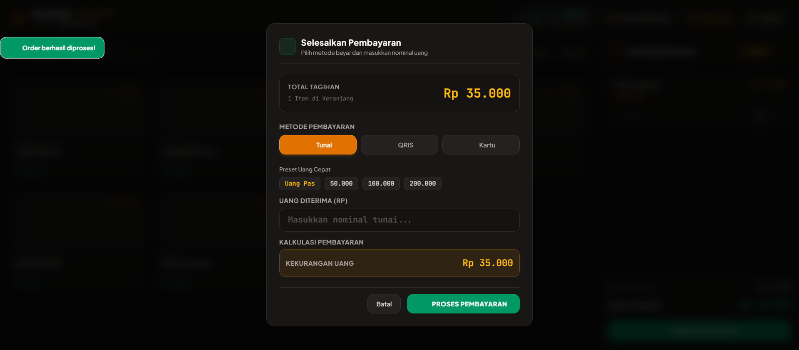
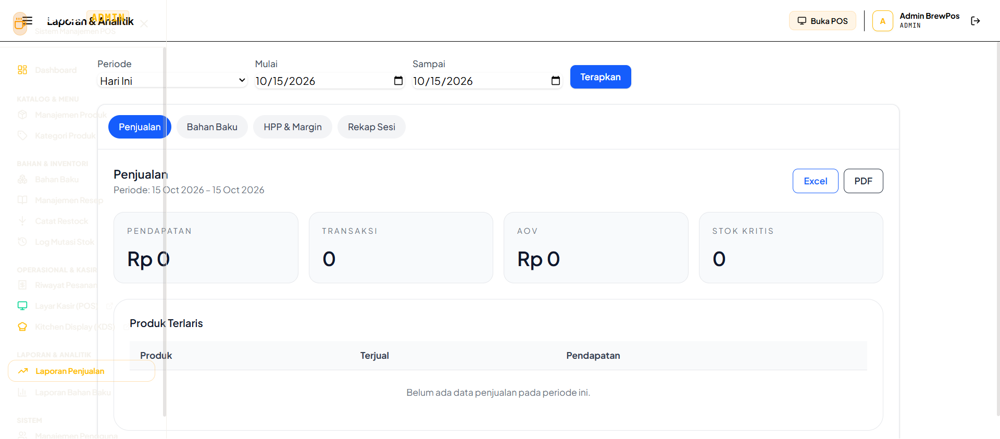

# ☕ BrewPOS — Modern Coffee Shop POS, KDS & Inventory System

<p align="center">
  
  
  
  
  
  
</p>

---

## 📌 Ringkasan Proyek

**BrewPOS** adalah sistem operasional kedai kopi *end-to-end* yang mengintegrasikan **Point of Sale (POS)** kasir berkecepatan tinggi, **Kitchen Display System (KDS)** *real-time* untuk barista, **Manajemen Inventori & Resep (Bill of Materials)** dengan kalkulasi HPP riil, serta **Pelaporan Finansial Komprehensif** dengan ekspor Excel dan PDF.

Dibangun dengan arsitektur tangguh berbasis **Laravel 11**, **Livewire 3**, **Alpine.js**, dan **MySQL 8.0 InnoDB**, sistem ini dirancang dengan penguncian pesimistik untuk menangani transaksi konkuren tinggi, mencegah *circular wait deadlocks*, mengamankan batas stok non-negatif via *database check constraints*, dan melindungi hak akses multi-role (RBAC).

---

## 🚀 Fitur Unggulan

### 1. 🛒 Point of Sale (POS) Kasir
- **Alur Kerja Cepat & Bebas Hambatan:** Pencarian instan dan penambahan item ke keranjang hanya dengan satu klik.
- **Dukungan Barcode Scanner Fisik:** Input pemindai hardware via keystroke `Enter` langsung mendeteksi barcode EAN/SKU unik dan menambahkan produk ke keranjang.
- **Navigasi Keyboard Cepat:** Tekan `/` untuk memfokuskan pencarian menu/barcode dan `Esc` untuk menutup modal checkout.
- **Multi-Size Cup Variants:** Mendukung variasi ukuran porsi (`S`, `M`, `L`) dengan penyesuaian harga dan takaran resep dinamis.
- **Kalkulasi Kembalian & Preset Uang Tunai:** Tombol cepat nominal uang (`Uang Pas`, `50.000`, `100.000`, `200.000`) dengan deteksi otomatis kekurangan bayar.
- **Perlindungan Double-Submit:** Penguncian atomik terdistribusi via `Cache::lock()` dan status eksekusi in-flight mencegah pesanan ganda.
- **Cetak Struk Thermal 80mm:** Tampilan struk nota monospace standar POS lengkap dengan rincian item, catatan pelanggan, pajak, kembalian, dan barcode.

### 2. 👨‍🍳 Kitchen Display System (KDS) Barista
- **Sinkronisasi Pesanan Real-time:** Setiap pesanan yang dibayar di kasir langsung muncul di layar KDS barista tanpa jeda (didukung polling 5s otomatis dan fallback WebSocket).
- **Tag Penuaan Pesanan Berwarna:** Label visual otomatis berdasarkan durasi tunggu pelanggan: `⚡ Fresh (< 1m)`, `⏳ Wait (1-3m)`, dan `🔥 Urgent (> 3m)`.
- **Transisi Status 1-Klik:** Alur pesanan: `Baru` $\to$ `Diracik` $\to$ `Siap Disajikan` $\to$ `Selesai / Diarsipkan`.
- **Fading Retention 2 Menit (SRS KDS-05):** Pesanan yang selesai disajikan tetap dipertahankan redup (50% opacity) selama 2 menit untuk mencegah disorientasi barista saat jam sibuk (*rush hour*).
- **Audio Chime:** Notifikasi denting suara via Web Audio API saat pesanan baru masuk ke dapur.

### 3. 📦 Manajemen Inventori & Resep (BOM)
- **Pengurangan Stok Otomatis Berbasis Resep:** Setiap pesanan secara proporsional mengurangi gramasi bahan baku (biji kopi, susu, sirup) sesuai ukuran cup pesanan.
- **Pessimistic Locking & Deadlock Elimination:** Penguncian baris `RawMaterial` diurutkan berdasarkan ID menaik (`orderBy('id', 'asc')->lockForUpdate()`), mengeliminasi risiko *circular wait deadlock*.
- **Restorasi Stok Saat Void:** Pembatalan pesanan mengembalikan kuantitas bahan baku ke gudang secara proporsional dan mencatat alasan pembatalan.
- **Audit Trail Mutasi Stok (`stock_movements`):** Catatan log append-only tidak dapat dihapus untuk setiap mutasi masuk (`in`), keluar (`out`), dan penyesuaian opname (`adjust`).
- **Database CHECK Constraint (`stock_qty >= 0`):** Menjamin integritas level database agar stok fisik tidak pernah bernilai negatif.
- **Peringatan Dini Bahan Menipis (*Low Stock Alert*):** Banner peringatan otomatis di dashboard admin dan badge status stok pada katalog POS.

### 4. 📊 Analisis Bisnis & Pelaporan Keuangan
- **Metrik Kinerja Penjualan:** Agregasi omset kotor, total transaksi, dan *Average Order Value* (AOV) dengan filter tanggal dinamis.
- **Kalkulasi HPP (COGS) & Margin Laba Riil:** Menghitung biaya pokok produksi per cup berdasarkan harga beli bahan baku supplier terbaru.
- **Peringkat Menu Terlaris (*Top Selling Items*):** Analisis produk penyumbang volume penjualan dan omset tertinggi (mengecualikan pesanan batal).
- **Multi-Format Export:** Ekspor satu klik laporan penjualan dan inventori ke format Microsoft Excel (`.xlsx`) dan Adobe PDF (`.pdf`).

### 5. 🔐 Sesi Kasir & Rekonsiliasi Kas Laci
- **Shift Guard Wajib:** Kasir diwajibkan membuka sesi shift dan memasukkan modal awal laci kasir sebelum mengakses layar transaksi.
- **Rekonsiliasi Otomatis Tutup Shift:** Sistem otomatis menghitung `expected_cash = modal_awal + penjualan_tunai` dan mencatat selisih (*difference*) kas fisik riil.
- **Proteksi IDOR:** Kasir dilarang melihat riwayat transaksi atau membatalkan pesanan milik sesi shift kasir lain.

---

## 📸 Galeri Tangkapan Layar (Visual Audit)

| 1. Login Akun Demo Artisanal | 2. Dashboard Eksekutif Admin |
| :---: | :---: |
|  |  |

| 3. Katalog POS Kasir | 4. Keranjang Belanja Aktif |
| :---: | :---: |
|  |  |

| 5. Modal Pembayaran & Kalkulator Kembalian | 6. Struk Thermal 80mm |
| :---: | :---: |
|  |  |

| 7. Kitchen Display System (KDS) Barista | 8. Laporan Penjualan & HPP |
| :---: | :---: |
|  |  |

| 9. Manajemen Resep & Takaran Bahan | 10. Master Bahan Baku & Restock |
| :---: | :---: |
|  |  |

---

## 👥 Akun Demo & Kredensial

Aplikasi telah dilengkapi seeder data awal dan tombol *1-click fill* pada layar login:

| Role | Email | Password | Akses Utama |
| :--- | :--- | :--- | :--- |
| **Admin** | `admin@brewpos.test` | `password` | Dashboard Manajemen, Master Data, Resep, Inventori, Laporan & Ekspor |
| **Kasir** | `cashier@brewpos.test` | `password` | Buka/Tutup Sesi Shift, Layar POS Kasir, Riwayat Sesi, Cetak Struk, Void |
| **Barista** | `barista@brewpos.test` | `password` | Kitchen Display System (`/kds`), Pembaruan Status Minuman |

---

## 🏗️ Arsitektur & Skema Database

- **Dokumentasi Desain Arsitektur:** [docs/ARCHITECTURE.md](docs/ARCHITECTURE.md)
- **Diagram Relasi Entitas (ERD):** [docs/ERD.md](docs/ERD.md)
- **Spesifikasi Kebutuhan Perangkat Lunak (SRS):** [docs/SRS.md](docs/SRS.md)
- **Spesifikasi Desain Perangkat Lunak (SDD):** [docs/SDD.md](docs/SDD.md)
- **Backlog Definition of Done (DoD):** [docs/AUTONOMOUS_DOD_BACKLOG.md](docs/AUTONOMOUS_DOD_BACKLOG.md)

---

## 🐳 Panduan Menjalankan dengan Docker

BrewPOS sepenuhnya di-containerisasi dengan Docker Compose. Tidak memerlukan instalasi lokal PHP, Nginx, maupun MySQL di komputer host.

### 1. Klon Repositori & Masuk Direktori
```bash
git clone https://github.com/<your-username>/BrewPOS.git
cd BrewPOS
```

### 2. Nyalakan Seluruh Container Docker
```bash
docker compose up -d
```
Container entrypoint secara otomatis menjalankan migrasi skema tabel dan melakukan database seeding.

### 3. Akses Aplikasi
- **Aplikasi BrewPOS:** [http://localhost:8000](http://localhost:8000)
- **phpMyAdmin Database Manager:** [http://localhost:8080](http://localhost:8080) *(User: `root`, Password: `secret`)*

### 4. Menjalankan Automated Test Suite
```bash
docker compose exec -T app php artisan test
```

Hasil eksekusi test runner:
```text
  Tests:    46 passed (276 assertions)
  Duration: 19.99s
```

### 5. Mematikan Service Docker
```bash
docker compose down
```

---

## 🛠️ Tech Stack & Dependencies

- **Backend Framework:** Laravel 11.x (PHP 8.2-FPM)
- **Reactive UI Engine:** Livewire 3.x & Alpine.js 3.x
- **Styling & Design System:** Tailwind CSS 3.x (Artisanal Dark Theme, WCAG AA Contrast)
- **Iconography:** Lucide Icons (Pinned SVG CDN `0.344.0`)
- **Database Engine:** MySQL 8.0 InnoDB
- **Exporting Engines:** `Maatwebsite/Laravel-Excel` (3.1) & `Barryvdh/Laravel-DomPDF` (3.1)
- **Containerization:** Docker & Docker Compose (Alpine Linux)
- **Testing & QA:** PHPUnit, Laravel Feature Tests, Playwright MCP Visual Auditor

---

## 📄 Lisensi
BrewPOS dirilis di bawah [MIT License](LICENSE).
