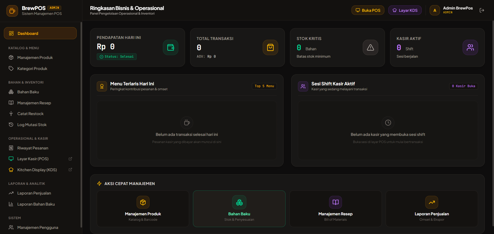
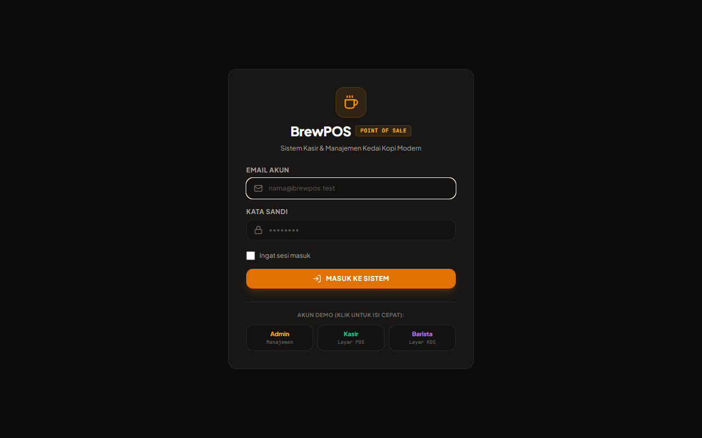
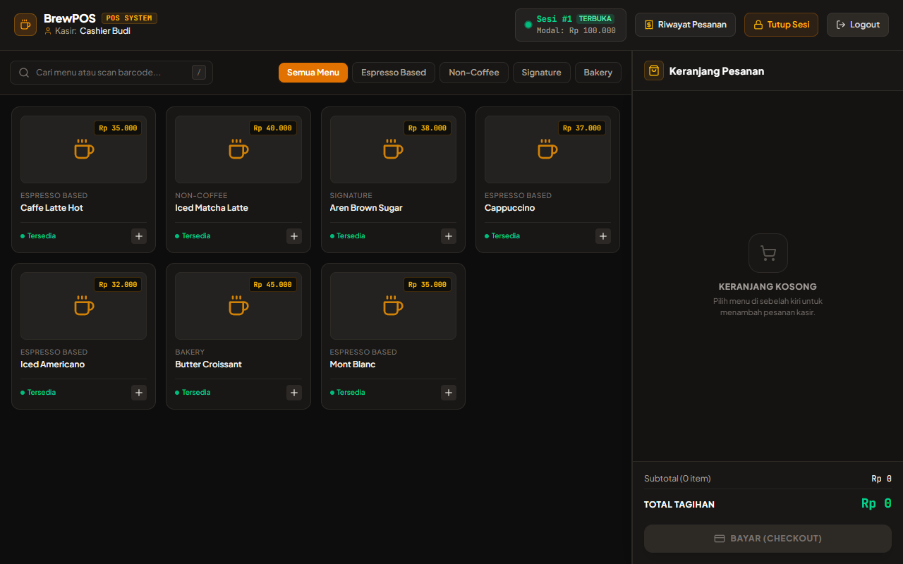
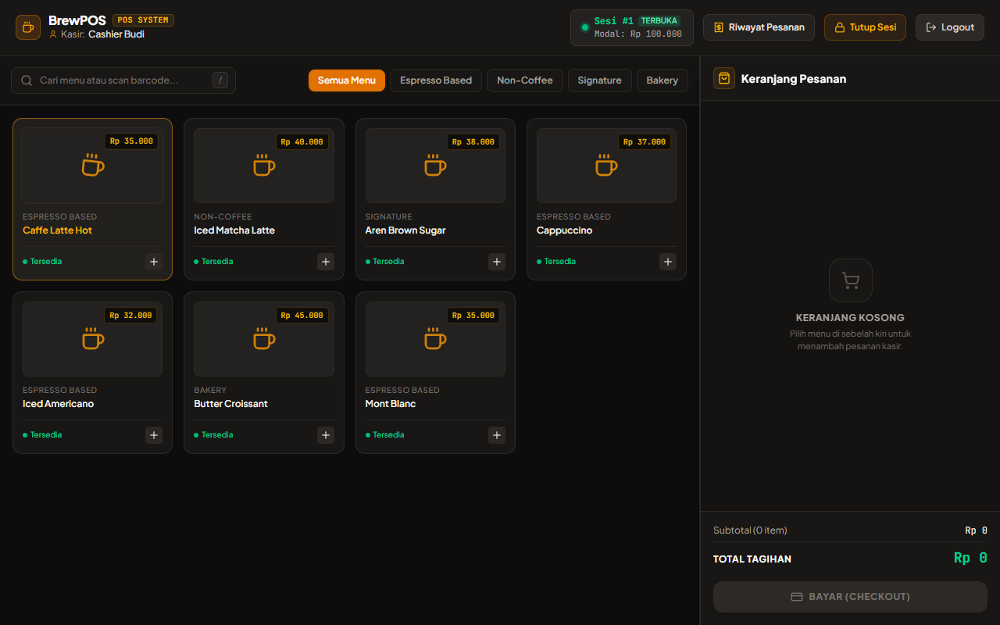
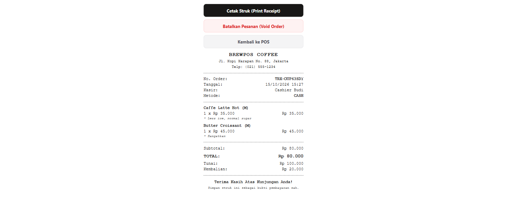
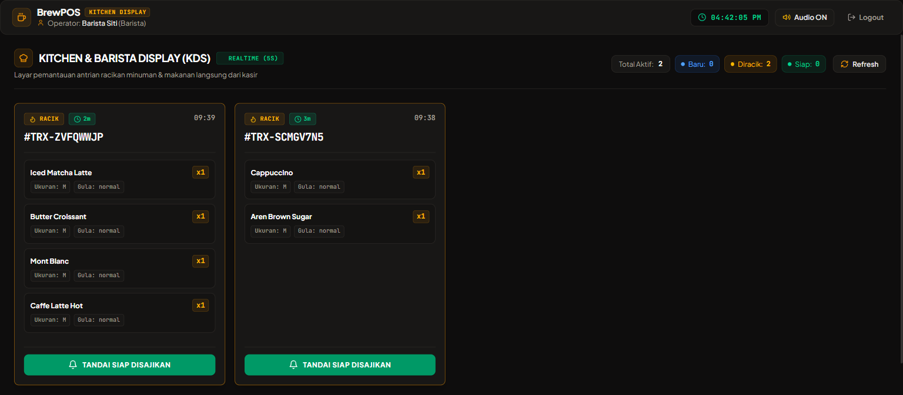
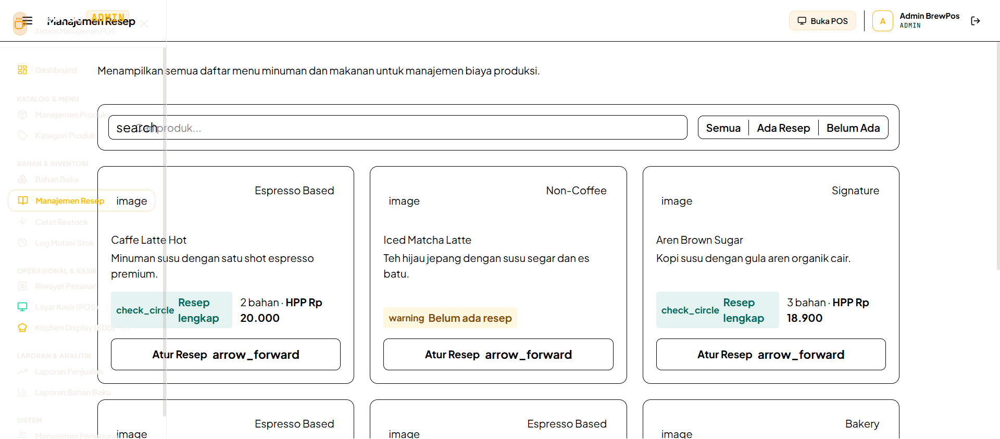
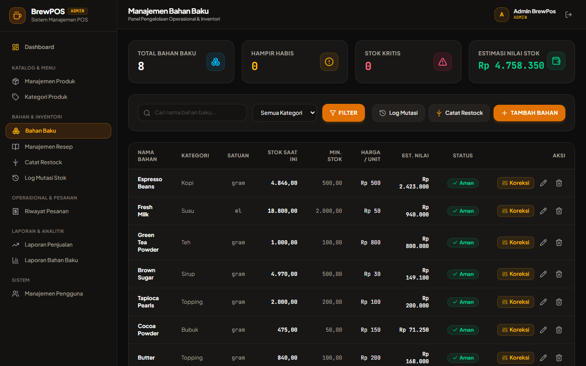

# BrewPOS — Modern Coffee Shop POS, KDS & Enterprise Inventory System

<p align="center">
  
</p>

Aplikasi web full-stack enterprise untuk operasional kedai kopi *end-to-end* yang mengintegrasikan **Point of Sale (POS)** kasir berkecepatan tinggi, **Kitchen Display System (KDS)** *real-time* untuk barista dapur, **Manajemen Inventori & Resep (Bill of Materials)** dengan kalkulasi HPP riil, serta **Pelaporan Finansial Komprehensif** dengan ekspor Excel dan PDF.

Dirancang sebagai bagian integral dari **Ekosistem Enterprise Finansial Lengkap (End-to-End Financial Ecosystem)** yang mensimulasikan integrasi arsitektur nyata tingkat industri antara sistem kasir point-of-sale modern (setara **Moka POS / Pawoon / Olsera**) dengan payment gateway modular berstandar enterprise (setara **Midtrans / Xendit / Stripe**).

Dibangun dengan arsitektur tangguh berbasis **Laravel 11**, **Livewire 3**, **Alpine.js**, dan **MySQL 8.0 InnoDB**, sistem ini dirancang dengan penguncian pesimistik untuk menangani transaksi konkuren tinggi, mencegah *circular wait deadlocks*, mengamankan batas stok non-negatif via *database check constraints*, dan melindungi hak akses multi-role (RBAC).

**Portfolio Engineering Project — Coffee Shop Enterprise POS & Kitchen Management Architecture**

---

## 🌐 Ekosistem Enterprise Finansial (End-to-End Financial Architecture)

Proyek ini dirancang tidak hanya sebagai aplikasi POS kasir yang berdiri sendiri (*standalone*), melainkan sebagai pilar operasional dalam **arsitektur ekosistem finansial modern end-to-end** yang mensimulasikan kolaborasi sistem nyata seperti integrasi antara **Moka POS / Pawoon** dengan payment gateway terkemuka seperti **Midtrans / Xendit**:

```
+-----------------------------------------------------------------------------------------------------+
|                                 END-TO-END FINANCIAL ECOSYSTEM                                      |
+-----------------------------------------------------------------------------------------------------+
|                                                                                                     |
|   [ FRONT-OFFICE / STORE LAYER ]                            [ FINANCIAL & SETTLEMENT LAYER ]        |
|   +---------------------------------+                       +-----------------------------------+   |
|   |           BrewPOS               |                       |      Modular Payment Gateway      |   |
|   |---------------------------------|                       |-----------------------------------|   |
|   | • Katalog POS & Barcode Scanner |                       | • REST API Payment Processing     |   |
|   | • Multi-Variant & Resep BOM     |  (1) Create Payment   | • Idempotency Key Guarantees      |   |
|   | • Kitchen Display System (KDS)  | --------------------> | • EMVCo QRIS Code Generation      |   |
|   | • Sesi Kasir & Cash Balancing   |                       | • Multi-tenant Merchant Isolation |   |
|   | • Shift Reconcile & Audit       |                       | • Financial Reconciliation Engine |   |
|   | • Webhook Receiver (/webhook)   | <-------------------- | • Automated Settlement & Payouts  |   |
|   +---------------------------------+  (2) HMAC Webhook     +-----------------------------------+   |
|                                                                                                     |
+-----------------------------------------------------------------------------------------------------+
```

### Alur Interaksi Ekosistem:
1. **Pendaftaran Transaksi (*Outbound API Dispatch*)**: Saat kasir memilih metode pembayaran QRIS di kasir BrewPOS, sistem secara otomatis menerbitkan request `POST /api/v1/payments` berotentikasi Bearer API Key ke backend Payment Gateway lengkap dengan `Idempotency-Key` untuk menjamin transaksi tidak pernah terduplikasi.
2. **Generasi QRIS Standar Nasional**: Payment Gateway mengembalikan representasi transaksi dan payload string EMVCo yang langsung dirender menjadi QR code interaktif di layar kasir pelanggan.
3. **Penyelesaian Otomatis Tanpa Intervensi Manual (*Zero Manual Reconcile*)**: Begitu pembayaran customer terkonfirmasi lunas di payment gateway, gateway menembakkan webhook asinkronus terenkripsi signature `X-Webhook-Signature` (HMAC-SHA256) ke endpoint BrewPOS (`/api/pos/qris/webhook`).
4. **Sinkronisasi Instan Dapur & Kasir**: Dalam hitungan sub-detik, modal kasir BrewPOS otomatis mendeteksi status lunas (*Paid*), stok bahan baku dipotong secara atomik melalui locking pesimistik, dan pesanan seketika terdistribusi ke layar KDS barista dapur.

---

## Konfigurasi Aplikasi

### Persyaratan Sistem
| Komponen | Versi | Keterangan |
|----------|-------|------------|
| PHP | 8.2+ / 8.3+ | Runtime PHP dengan ekstensi `pdo_mysql`, `bcmath`, `gd`, `intl` |
| Composer | 2.x | PHP Dependency Manager |
| Node.js & npm | 20+ / 10+ | Frontend asset bundler (Vite & Tailwind CSS) |
| MySQL | 8.0+ | Database Relasional dengan Engine InnoDB |
| Docker & Compose | 24+ | Opsional untuk containerized setup |

### Database (MySQL)

Aplikasi menggunakan **MySQL 8.0 (InnoDB)** untuk memastikan integritas transaksi kasir, konsistensi pengurangan bahan baku resep, dan eksekusi atomik dengan ACID compliance.

Konfigurasi koneksi ada di `.env` (dapat disalin dari `.env.example`):

```properties
APP_NAME=BrewPOS
APP_ENV=local
APP_DEBUG=true
APP_URL=http://localhost:8088

DB_CONNECTION=mysql
DB_HOST=127.0.0.1
DB_PORT=3306
DB_DATABASE=brewpos
DB_USERNAME=root
DB_PASSWORD=secret

# Integrasi Payment Gateway (Opsional / Sandbox)
PAYMENT_GATEWAY_URL=http://host.docker.internal:3005/api/v1
PAYMENT_GATEWAY_SECRET_KEY=sk_test_example
PAYMENT_GATEWAY_WEBHOOK_SECRET=whsec_example
```

---

## Menjalankan Aplikasi

### 1. Opsi Docker Compose (Paling Cepat & Direkomendasikan)
```bash
docker compose up -d --build
```
> Menjalankan seluruh stack container secara otomatis:
> - **Nginx Web Server**: port `8088` (`http://localhost:8088`)
> - **PHP 8.2-FPM App**: `brewpos-app`
> - **MySQL 8.0 Database**: port `3306` (`http://localhost:3306`)
> - **phpMyAdmin UI**: port `8080` (`http://localhost:8080`, User: `root`, Password: `secret`)

Entrypoint Docker secara otomatis melakukan migrasi skema tabel dan database seeder.

### 2. Opsi Manual / Bare-Metal
```bash
# 1. Clone repositori
git clone https://github.com/vendetta2020/BrewPos.git
cd BrewPos

# 2. Install dependency PHP & JS
composer install
npm install
npm run build

# 3. Setup Environment
cp .env.example .env
php artisan key:generate

# 4. Migrasi & Seeding Data
php artisan migrate --seed

# 5. Jalankan Local Server
php artisan serve --port=8088
```

Akses aplikasi di:
- **Web App BrewPOS:** `http://localhost:8088`
- **Layar POS Kasir:** `http://localhost:8088/pos`
- **Kitchen Display System (KDS):** `http://localhost:8088/kds`
- **Portal Admin:** `http://localhost:8088/admin/dashboard`

---

## Akun yang Tersedia & Kredensial Pengujian

Aplikasi dilengkapi *demo seeder* dan tombol *1-click fill* pada layar login:

| Role | Email | Password | Hak Akses Utama |
|------|-------|----------|-----------------|
| **Admin** | `admin@brewpos.test` | `password` | Manajemen Menu, Resep HPP, Gudang Bahan Baku, Pengguna, Laporan & Ekspor |
| **Kasir** | `cashier@brewpos.test` | `password` | Buka/Tutup Shift Laci Kasir, Layar Kasir POS, Cetak Struk, Riwayat Sesi, Void |
| **Barista** | `barista@brewpos.test` | `password` | Layar KDS Dapur (`/kds`), Pembaruan Status Minuman Masuk & Selesai |

---

## Fitur Utama

| Modul | Rute / Fitur | Deskripsi |
|-------|--------------|-----------|
| **POS Kasir** | `/pos` | Pemilihan menu cepat, dukungan pemindai barcode fisik (`Enter` trigger), keyboard shortcut (`/`, `Esc`), varian cup (`S`, `M`, `L`), dan kalkulator kembalian otomatis |
| **Pencegahan Double-Submit** | In-flight Guard | Penguncian terdistribusi via `Cache::lock()` mencegah duplikasi transaksi saat kasir menekan tombol bayar berulang |
| **Struk Thermal 80mm** | `/cashier/orders/{id}/receipt` | Nota cetak monospace standar thermal lengkap dengan rincian item pesanan, varian porsi, catatan khusus, dan barcode |
| **Kitchen Display (KDS)** | `/kds` | Sinkronisasi pesanan dapur tanpa reload, visual aging tags (`Fresh <1m`, `Wait 1-3m`, `Urgent >3m`), transisi status 1-klik, dan audio chime Web Audio API |
| **Fading Retention KDS** | KDS Board | Pesanan yang sudah selesai disajikan dipertahankan secara redup (50% opacity) selama 2 menit agar barista tidak disorientasi saat antrean padat |
| **Inventori Resep (BOM)** | `/admin/recipes` | Pengurangan stok bahan baku otomatis saat pesanan terbayar secara proporsional sesuai ukuran cup |
| **Deadlock Elimination** | Atomic Deduction | Penguncian baris `RawMaterial` diurutkan terurut menaik (`orderBy('id', 'asc')->lockForUpdate()`) untuk mengeliminasi circular wait |
| **Integritas Stok Fisik** | Database CHECK | Constraint level database `CHECK (stock_qty >= 0)` menjamin stok bahan baku tidak pernah bernilai negatif |
| **Restorasi Stok Saat Void** | Admin / Cashier Void | Pembatalan transaksi pesanan otomatis mengembalikan kuantitas bahan baku ke gudang dan mencatat log alasan pembatalan |
| **Audit Mutasi Stok** | `/admin/inventory/movements` | Log append-only tidak dapat dihapus untuk setiap mutasi masuk (`in`), keluar (`out`), dan penyesuaian opname (`adjust`) |
| **Sesi Kasir & Shift** | `/cashier/session` | Mewajibkan modal awal sebelum kasir bertransaksi dan menghitung selisih rekonsiliasi kas saat tutup shift |
| **Laporan & Analisis** | `/admin/reports` | Agregasi penjualan, Average Order Value (AOV), perhitungan HPP (COGS) riil, dan margin laba bersih |
| **Ekspor Multi-Format** | Excel & PDF | Unduh laporan penjualan dan inventori dengan format Microsoft Excel (`.xlsx`) dan Adobe PDF (`.pdf`) |

---

## Galeri Tangkapan Layar

| 1. Login Akun Demo Artisanal | 2. Dashboard Eksekutif Admin |
| :---: | :---: |
|  |  |

| 3. Katalog POS Kasir | 4. Keranjang Belanja Aktif |
| :---: | :---: |
|  |  |

| 5. Struk Thermal 80mm | 6. Kitchen Display System (KDS) |
| :---: | :---: |
|  |  |

| 7. Manajemen Resep & BOM | 8. Master Bahan Baku & Restock |
| :---: | :---: |
|  |  |

---

## API Endpoints

BrewPOS menyediakan REST API untuk integrasi kasir eksternal dan webhook pembayaran:

### QRIS & POS Gateway API
- `POST /api/pos/qris/generate` — Generate transaksi dan payload QRIS EMVCo dinamis
- `GET /api/pos/qris/{reference}/status` — Polling status pembayaran QRIS transaksi
- `POST /api/pos/qris/webhook` — Webhook endpoint penerima notifikasi pelunasan dari Payment Gateway
- `POST /api/pos/qris/simulate-pay` — Simulasi pelunasan manual untuk pengujian sandbox

---

## File Penting

| File | Deskripsi |
|------|-----------|
| [CheckoutModal.php](app/Http/Livewire/Pos/CheckoutModal.php) | Komponen Livewire modal checkout kasir, alur pembayaran tunai/QRIS, dan in-flight double submit guard |
| [PosInterface.php](app/Http/Livewire/Pos/PosInterface.php) | Komponen reaktif katalog POS kasir, keranjang belanja, dan pemindai barcode fisik |
| [KdsBoard.php](app/Http/Livewire/Kds/KdsBoard.php) | Layar dapur barista, aging time tags, dan transisi status penyajian pesanan |
| [InventoryDeductionService.php](app/Services/InventoryDeductionService.php) | Layanan pengurangan dan restorasi stok bahan baku dengan locking pesimistik bebas deadlock |
| [QrisService.php](app/Services/QrisService.php) | Generator string payload EMVCo QRIS, kalkulasi CRC16-CCITT, dan rendering SVG QR code |
| [PosQrisController.php](app/Http/Controllers/Api/PosQrisController.php) | API Controller penanganan generate QRIS dan webhook notifikasi pelunasan |
| [Order.php](app/Models/Order.php) | Model pesanan, relasi item, status lifecycle, dan mutasi pembayaran |
| [RawMaterial.php](app/Models/RawMaterial.php) | Model inventori bahan baku dengan constraint batas stok non-negatif |

---

## Troubleshooting

### Port 8088 Konflik dengan Service Lain
Ubah port pada file `docker-compose.yml`:
```yaml
services:
  web:
    ports:
      - '8089:80'
```

### Docker Permission / Storage Cache
Jika terjadi error permission pada folder `storage`:
```bash
docker compose exec -T app chmod -R 775 storage bootstrap/cache
```

### Reset Database & Jalankan Ulang Seeder
```bash
docker compose exec -T app php artisan migrate:fresh --seed
```

---

## Pengujian & Verifikasi Kualitas

Sistem dilengkapi pengujian otomatis komprehensif mencakup unit test, concurrency safety, deadlock prevention, dan end-to-end user journeys:

```bash
# Menjalankan seluruh test suite di dalam container Docker
docker compose exec -T app php artisan test
```

Hasil eksekusi test runner:
```text
   PASS  Tests\Unit\ExampleTest
   PASS  Tests\Unit\QrisServiceTest
   PASS  Tests\Feature\BrewPosFlowTest
   PASS  Tests\Feature\PosQrisApiTest

  Tests:    60 passed (380 assertions)
  Duration: 17.65s
```

---

## Tim Pengembang

Dikembangkan sebagai **Advanced Point of Sale & Kitchen Operations Engineering Showcase** yang mendemonstrasikan implementasi sistem transaksi kasir konkuren, arsitektur event-driven dapur, dan manajemen inventori berstandar industri F&B.

---

## Lisensi
BrewPOS dirilis di bawah lisensi [MIT License](LICENSE).
