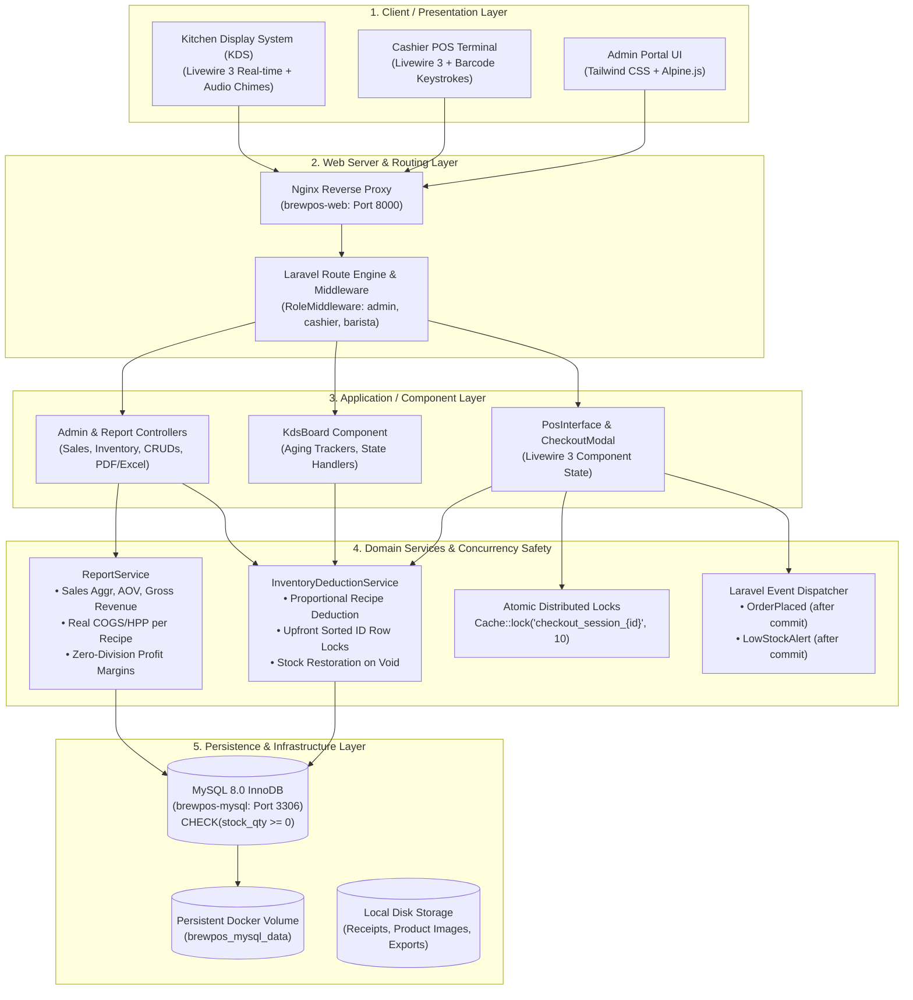
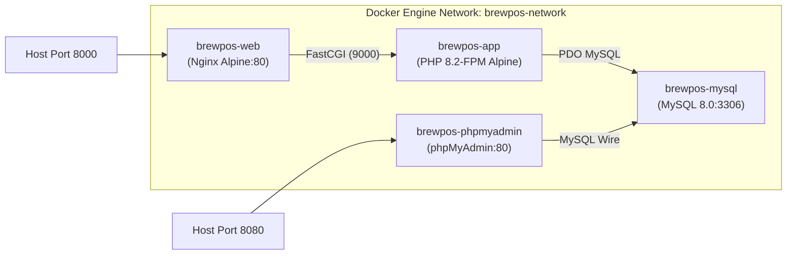

# Architecture & System Design — BrewPOS

Dokumen ini mendokumentasikan arsitektur teknis, pola desain (*design patterns*), alur data *end-to-end*, serta mitigasi konkurensi pada aplikasi **BrewPOS** (Point of Sale & Kitchen Display System).

---

## 1. High-Level Multi-Tier Architecture Diagram



---

## 2. POS Checkout & Order Lifecycle Sequence Diagram

Diagram interaksi di bawah menggambarkan urutan eksekusi transaksi dari saat kasir memproses pembayaran hingga pesanan muncul di layar barista dan disajikan ke pelanggan:

```mermaid
sequenceDiagram
    autonumber
    actor Cashier as Kasir (POS)
    participant POS as CheckoutModal (Livewire)
    participant Lock as Cache::lock()
    participant DB as DB::transaction()
    participant Inv as InventoryDeductionService
    participant Event as Event Dispatcher
    actor Barista as Barista (KDS)

    Cashier->>POS: Klik "Proses Pembayaran" (Uang Pas / Tunai)
    POS->>POS: Validasi Server (cash_paid >= total)
    POS->>Lock: Peroleh Atomic Distributed Lock (10s)
    
    rect rgb(24, 23, 22)
        Note over POS,DB: Database Transaction (3 Retries)
        POS->>DB: Kunci Pesimistik CashierSession::lockForUpdate()
        POS->>Inv: deductOrderStock(orderItems)
        Inv->>DB: Kunci Baris RawMaterial::orderBy('id', 'asc')->lockForUpdate()
        Inv->>Inv: Validasi Ketersediaan Bahan (stock_qty >= required)
        Inv->>DB: Kurangi stock_qty & Simpan StockMovement ('out')
        POS->>DB: Buat Record Order (status: 'paid') & OrderItems
    end

    DB-->>POS: Commit Transaksi Sukses
    POS->>Lock: Lepas Atomic Distributed Lock
    POS->>Event: OrderPlaced::dispatchAfterCommit(order)
    POS-->>Cashier: Tampilkan Struk Pembayaran & Kembalian

    opt Real-time Polling / Broadcast
        Event->>Barista: Notifikasi Audio Web Audio API Chime
        Barista->>Barista: KDS Otomatis Render Kartu Tiket (#TRX-XXXX)
    end

    Barista->>DB: Klik "Mulai Racik Pesanan" (status: 'processing')
    Barista->>DB: Klik "Tandai Siap Disajikan" (status: 'ready')
    Barista->>DB: Klik "Selesai / Arsipkan" (status: 'completed')
    Note over Barista: Tiket meredup (50% opacity) selama 2 menit, lalu hilang
```



---

## 3. Concurrency & Deadlock Elimination Pattern

### 3.1 Masalah Potensial (Circular Wait Deadlock)
Ketika Kasir A membeli *Espresso* (membutuhkan Kopi ID: 1, Cup ID: 7) dan pada detik bersamaan Kasir B membeli *Cappuccino* (membutuhkan Cup ID: 7, Susu ID: 2, Kopi ID: 1):
- Tanpa standarisasi urutan, Kasir A mengunci ID 1 lalu meminta lock ID 7.
- Kasir B mengunci ID 7 lalu meminta lock ID 1.
- Terjadi **Circular Deadlock** yang menyebabkan database MySQL melempar `Deadlock found when trying to get lock`.

### 3.2 Solusi Desain BrewPOS (`orderBy('id', 'asc')`)
Seluruh service (`InventoryDeductionService`) menerapkan pengurutan deterministik ID bahan baku sebelum penguncian pesimistik:

```php
// Upfront sorted deterministic ID row locking
$materials = RawMaterial::whereIn('id', $materialIds)
    ->orderBy('id', 'asc')
    ->lockForUpdate()
    ->get()
    ->keyBy('id');
```
Dengan selalu mengunci dari ID terkecil ke terbesar (`1 -> 2 -> 7`), *circular wait* secara matematis mustahil terjadi.

---

## 4. Role-Based Access Control (RBAC) Architecture

Aplikasi membagi pengguna ke dalam 3 role operasional dengan batasan ketat:

| Feature / URL Route | Admin (`admin`) | Kasir (`cashier`) | Barista (`barista`) | Tamu (`guest`) |
| :--- | :---: | :---: | :---: | :---: |
| **Admin Dashboard (`/dashboard`)** | ✅ Akses Penuh | ❌ 403 Forbidden | ❌ 403 Forbidden | ❌ 302 Login |
| **Katalog & Master Produk (`/admin/products`)** | ✅ CRUD | ❌ 403 Forbidden | ❌ 403 Forbidden | ❌ 302 Login |
| **Manajemen Resep (`/admin/inventory/recipes`)** | ✅ CRUD | ❌ 403 Forbidden | ❌ 403 Forbidden | ❌ 302 Login |
| **Restock & Koreksi Stok (`/admin/inventory/...`)** | ✅ Akses Penuh | ❌ 403 Forbidden | ❌ 403 Forbidden | ❌ 302 Login |
| **Laporan Omset & Ekspor (`/admin/reports/...`)** | ✅ View & Export | ❌ 403 Forbidden | ❌ 403 Forbidden | ❌ 302 Login |
| **POS Terminal Kasir (`/pos`)** | ✅ Akses Penuh | ✅ Buka Shift Wajib | ❌ 403 Forbidden | ❌ 302 Login |
| **Riwayat Transaksi Kasir (`/cashier/orders`)** | ✅ Semua Order | ✅ Sesi Aktif Saja | ❌ 403 Forbidden | ❌ 302 Login |
| **Kitchen Display System (`/kds`)** | ✅ Monitoring | ❌ 403 Forbidden | ✅ Update Status | ❌ 302 Login |

---

## 5. Deployment & Container Topology

BrewPOS dikemas dalam arsitektur container Docker yang terisolasi dan dapat direproduksi:


