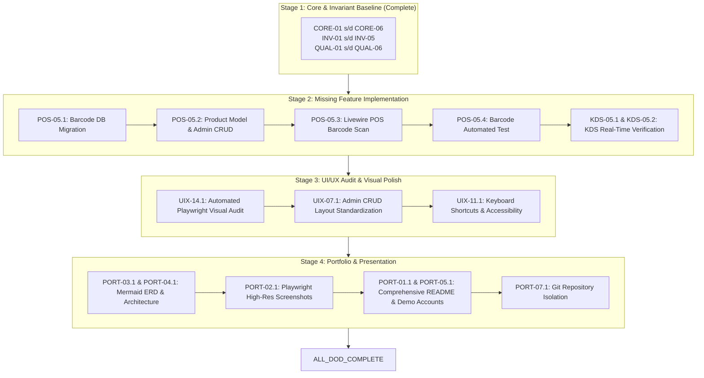

# AUTONOMOUS DOD BACKLOG — BREWPOS SYSTEM

> **Document Status**: Authoritative DoD Backlog & Acceptance Checklist  
> **Workflow**: Autonomous Implementer–QA/Auditor Orchestration with Human Approval Gate  
> **Repository**: `C:\xampp\htdocs\BrewPOS`  
> **Reference Authority**: The authoritative DoD criteria are preserved verbatim from the project owner.

---

## 1. Verbatim Authoritative Definition of Done

The following checklist is the authoritative acceptance authority. No criterion may be removed, weakened, or silently reinterpreted.

### CORE
- Order lifecycle consistent
- Checkout atomic
- Stock cannot become negative
- Concurrent checkout safe
- Void order works
- Inventory restored after void

### POS
- Cashier session reliable
- Payment works
- Receipt works
- Order history works
- Barcode works

### INVENTORY
- Recipe deduction works
- Restock works
- Adjustment works
- Stock movements auditable
- Low stock works

### KDS
- New order appears
- Processing works
- Ready works
- Completed works
- Real-time update works

### REPORT
- Sales
- HPP
- Margin
- Top products
- Inventory
- Cashier session

### UI/UX & DESIGN QUALITY
- Consistent visual design system (colors, typography, spacing, components)
- UI feels intentionally designed, not generic AI-generated
- Clear visual hierarchy and readable information density
- POS optimized for fast cashier workflows
- KDS optimized for quick order scanning and status recognition
- Admin dashboard prioritizes useful business information
- Consistent layouts across pages
- Responsive on desktop, tablet, and mobile where relevant
- Loading, empty, error, and success states designed consistently
- Forms, tables, modals, and buttons have consistent behavior
- Accessibility basics: contrast, keyboard navigation, and readable text
- No unnecessary gradients, excessive rounded cards, decorative icons, or generic dashboard patterns
- No broken layouts, overflow, inconsistent spacing, or awkward alignment
- Visual audit completed on all major pages

### QUALITY
- Automated tests
- Authorization tested
- Validation complete
- Error handling
- No secrets
- Seed data

### PORTFOLIO
- README
- Screenshots
- ERD
- Architecture diagram
- Demo account
- Deployment
- Clean GitHub repository

---

## 2. Traceability & Detailed Task Specification Matrix

Status Legend:
- `VERIFIED_PASS`: Empirically verified via automated tests, code audit, or runtime execution.
- `PARTIAL`: Core backend or basic UI exists, but full integration, fallback, or responsive coverage is incomplete.
- `VERIFIED_FAIL`: Explicitly missing or failing repository inspection.
- `NOT_VERIFIED`: Requires standalone visual or runtime audit suite.

### 2.1 CORE (Order, Transaction & Concurrency Integrity)

| Task ID | Original Criterion | Status | Relevant Files | Existing Verification & Evidence | Dependencies | Risks & Acceptance Invariants |
| :--- | :--- | :---: | :--- | :--- | :--- | :--- |
| **CORE-01** | Order lifecycle consistent | `VERIFIED_PASS` | `app/Models/Order.php` `app/Http/Livewire/Kds/KdsBoard.php` `routes/web.php` | Status transitions (`pending` $\to$ `paid` $\to$ `processing` $\to$ `ready` $\to$ `completed` $\to$ `cancelled`). `KdsBoard::updateStatus` rejects transitions on cancelled orders. Test: `test_barista_can_update_kds_status`, `test_kds_cannot_update_status_on_cancelled_order_under_concurrency`. | None | Order status cannot skip steps or mutate post-cancellation. |
| **CORE-02** | Checkout atomic | `VERIFIED_PASS` | `app/Http/Livewire/Pos/CheckoutModal.php` `app/Services/InventoryDeductionService.php` | All order creation steps wrapped in `DB::transaction(..., 3)`. Stock deduction and movement creation roll back cleanly on any failure. Test: `test_checkout_transaction_is_atomic_and_rolls_back_on_failure`. | None | No partial orders or orphaned order items on checkout failure. |
| **CORE-03** | Stock cannot become negative | `VERIFIED_PASS` | `database/migrations/2026_10_15_000001_add_check_constraints_to_raw_materials_table.php` `app/Models/RawMaterial.php` `InventoryDeductionService.php` | 1. DB CHECK constraint `stock_qty >= 0` 2. Model `booted()` saving guard & `decrement()` override 3. Fail-fast `validateStockForCart` Test: `test_checkout_fails_and_does_not_deduct_when_stock_is_insufficient`, `test_raw_material_cannot_be_saved_with_negative_stock`, `test_raw_material_decrement_cannot_reduce_stock_below_zero`. | None | Zero stock overdraft allowed under any execution vector. |
| **CORE-04** | Concurrent checkout safe | `VERIFIED_PASS` | `app/Http/Livewire/Pos/CheckoutModal.php` `InventoryDeductionService.php` | 1. `Cache::lock("checkout_session_{$session->id}", 10)` blocks double-clicks 2. Deterministic ascending ID row locking (`RawMaterial::whereIn()->orderBy('id')->lockForUpdate()`) eliminates deadlocks 3. CashierSession row lock re-check. Test: `test_checkout_is_protected_against_concurrent_duplicate_requests_via_session_lock`, `test_competing_checkouts_exhausting_stock_serializes_and_aborts_excess_orders`. | `CORE-02`, `CORE-03` | No race conditions causing negative stock or phantom duplicate orders. |
| **CORE-05** | Void order works | `VERIFIED_PASS` | `app/Models/Order.php` `app/Http/Controllers/Cashier/PosController.php` `resources/views/cashier/receipt.blade.php` `resources/views/cashier/orders/index.blade.php` | `Order::void()` with row locking `lockForUpdate()`. Authorization ensures cashiers only void active session orders; admins can void any. Test: `test_order_can_be_voided_and_restores_inventory`, `test_concurrent_order_void_is_idempotent_and_prevents_duplicate_stock_restoration`. | `CORE-01` | Idempotent voiding; concurrent duplicate void requests throw domain exception. |
| **CORE-06** | Inventory restored after void | `VERIFIED_PASS` | `app/Services/InventoryDeductionService.php` `app/Models/StockMovement.php` | `restoreOrderStock(Order $order)` increments `stock_qty` with deterministic ascending ID locking and writes `StockMovement` with type `'in'`. Test: `test_order_can_be_voided_and_restores_inventory`. | `CORE-05` | Exact ingredient quantity restored; stock movements accurately reflect return. |

---

### 2.2 POS (Point of Sale Interface & Hardware)

| Task ID | Original Criterion | Status | Relevant Files | Existing Verification & Evidence | Dependencies | Risks & Acceptance Invariants |
| :--- | :--- | :---: | :--- | :--- | :--- | :--- |
| **POS-01** | Cashier session reliable | `VERIFIED_PASS` | `app/Models/CashierSession.php` `app/Http/Controllers/Cashier/CashierSessionController.php` `app/Http/Controllers/Cashier/PosController.php` | Shift opening records `opening_balance`. Unopened shift redirects kasir away from `/pos`. Shift close tallies `expected_cash = opening_balance + cash_sales` and records `difference`. Test: `test_cashier_must_open_session_before_accessing_pos`, `test_cashier_can_open_session_and_access_pos`. | None | No orders can be rung up without an active open session. |
| **POS-02** | Payment works | `VERIFIED_PASS` | `app/Http/Livewire/Pos/CheckoutModal.php` `resources/views/livewire/pos/checkout-modal.blade.php` | Payment methods: cash, QRIS, card. For cash, enforces `cashPaid >= total`, live recalculation of change, quick cash buttons. Test: `test_cash_payment_fails_if_cash_paid_is_zero_or_insufficient`. | `CORE-02` | Underpayment rejected; change displayed accurately. |
| **POS-03** | Receipt works | `VERIFIED_PASS` | `app/Http/Controllers/Cashier/PosController.php@receipt` `app/Models/OrderItem.php` `resources/views/cashier/receipt.blade.php` | Printable thermal receipt view with itemization, taxes, cashier name, session number, and IDOR protection against cross-cashier snooping. Fixed eager load relation (`orderItems.variant` and alias `productVariant` on `OrderItem`). Test: `test_cashier_cannot_access_receipt_or_void_another_session_order_idor_protection`, `test_receipt_renders_correctly_with_order_items_and_variants_without_500_crash`. | `POS-02` | Receipt inaccessible to unauthorized cashiers; print CSS format; renders multi-item and variant orders without crash. |
| **POS-04** | Order history works | `VERIFIED_PASS` | `app/Http/Controllers/Cashier/PosController.php` `resources/views/cashier/orders/index.blade.php` `resources/views/admin/orders/index.blade.php` | Cashier can view orders in active shift (`/cashier/orders`, SRS POS-10). Admin can view all orders with search & status filters (`/admin/orders`). Test: `test_cashier_can_view_active_session_order_history`. | `POS-01` | Sift-scoped history for cashier; company-wide for admin. |
| **POS-05** | Barcode works | `VERIFIED_PASS` | `database/migrations/2026_10_15_000002_add_barcode_to_products_table.php` `app/Models/Product.php` `app/Http/Controllers/Admin/ProductController.php` `resources/views/admin/products/create.blade.php` `resources/views/admin/products/edit.blade.php` `app/Http/Livewire/Pos/PosInterface.php` `resources/views/livewire/pos/pos-interface.blade.php` | Column `barcode VARCHAR(64)` unique & nullable. Admin form creates/updates barcode with validation. POS search queries name and barcode; `wire:keydown.enter.prevent="scanBarcode"` enables instantaneous hardware barcode scanner cart additions. Test: `test_admin_can_create_and_update_product_with_unique_barcode`, `test_pos_can_search_and_scan_product_by_barcode`. | `POS-01` | Scanner Enter event triggers cart addition with stock check and clears input. |

---

### 2.3 INVENTORY (Materials, Recipes & Tracking)

| Task ID | Original Criterion | Status | Relevant Files | Existing Verification & Evidence | Dependencies | Risks & Acceptance Invariants |
| :--- | :--- | :---: | :--- | :--- | :--- | :--- |
| **INV-01** | Recipe deduction works | `VERIFIED_PASS` | `app/Services/InventoryDeductionService.php` `app/Observers/OrderItemObserver.php` `app/Models/ProductRecipe.php` | Multi-size recipe deduction (S, M, L, and `'all'`). Observer executes atomic stock decrement on order creation. Test: `test_pos_checkout_creates_order_and_updates_kds`, `test_multi_item_order_void_restores_all_recipe_raw_materials_proportionally`. | `CORE-02`, `CORE-03` | Exact recipe proportion deducted per size variant. |
| **INV-02** | Restock works | `VERIFIED_PASS` | `app/Http/Controllers/Inventory/RestockController.php` `resources/views/admin/inventory/restock-form.blade.php` | Increments `stock_qty` atomically, updates `cost_per_unit` for accurate HPP, writes `StockMovement` type `'in'` inside `DB::transaction(..., 3)`. Test: `test_admin_can_restock_raw_material_and_updates_cost_and_records_movement`. | None | Restock updates inventory immediately with cost audit trail. |
| **INV-03** | Adjustment works | `VERIFIED_PASS` | `app/Http/Controllers/Inventory/RawMaterialController.php@adjust` `resources/views/inventory/raw-materials/index.blade.php` | Admin can adjust physical count with recorded reason via interactive modal; wrapped in `DB::transaction(..., 3)` with `lockForUpdate()`; writes `StockMovement` type `'adjust'`. Test: `test_admin_can_adjust_stock_manually_with_reason_and_records_movement`. | None | Manual corrections require mandatory reason string. |
| **INV-04** | Stock movements auditable | `VERIFIED_PASS` | `app/Models/StockMovement.php` `app/Http/Controllers/Inventory/RawMaterialController.php@movements` `resources/views/admin/inventory/movements.blade.php` | Dedicated audit log view `/admin/inventory/movements` with search, type filter (`in`/`out`/`adjust`), material filter, and sidebar navigation. Test: `test_stock_movements_audit_log_is_viewable_and_filterable_by_admin`. | `INV-01`, `INV-02` | Tamper-proof log of all physical inventory changes. |
| **INV-05** | Low stock works | `VERIFIED_PASS` | `app/Events/LowStockAlert.php` `InventoryDeductionService.php` `resources/views/admin/dashboard.blade.php` `resources/views/livewire/pos/pos-interface.blade.php` | Dispatches `LowStockAlert` after commit when `stock_qty <= min_stock_qty`. Dashboard displays alert banner and counts. POS catalog dynamically marks recipes as `Tersedia`, `Stok Menipis`, or `Habis` and prevents adding out-of-stock items. Test: `test_pos_catalog_displays_accurate_stock_status_for_recipes`, `test_pos_interface_prevents_adding_out_of_stock_item_to_cart`, `test_low_stock_status_and_dashboard_alerts_reflect_accurately`. | `INV-01` | Admin notified of critical materials; out-of-stock menu cannot be added. |

---

### 2.4 KDS (Kitchen Display System)

| Task ID | Original Criterion | Status | Relevant Files | Existing Verification & Evidence | Dependencies | Risks & Acceptance Invariants |
| :--- | :--- | :---: | :--- | :--- | :--- | :--- |
| **KDS-01** | New order appears | `VERIFIED_PASS` | `app/Events/OrderPlaced.php` `app/Http/Livewire/Kds/KdsBoard.php` `resources/views/livewire/kds/kds-board.blade.php` | Dispatched after commit on checkout; Livewire listens on `echo:orders,order-placed` and queries active orders. Order ticket displays items, sizes, notes, integer aging tag, and "Mulai Racik Pesanan" button. Test: `test_pos_checkout_creates_order_and_updates_kds`, `test_new_paid_order_appears_on_kds_board_with_items_and_aging_tag`. | `CORE-01` | Paid orders immediately enter barista queue. |
| **KDS-02** | Processing works | `VERIFIED_PASS` | `app/Http/Livewire/Kds/KdsBoard.php` `resources/views/livewire/kds/kds-board.blade.php` | Barista/admin can transition status to `processing`. Pessimistic locking prevents race conditions. Card turns amber with "⚡ RACIK" badge and "Tandai Siap Disajikan" button. Test: `test_barista_can_update_kds_status`, `test_kds_lifecycle_full_transitions_and_fading_retention`. | `KDS-01` | Protected by auth and barista/admin role middleware. |
| **KDS-03** | Ready works | `VERIFIED_PASS` | `app/Http/Livewire/Kds/KdsBoard.php` `resources/views/livewire/kds/kds-board.blade.php` | Barista marks drink `ready`. Card changes border to emerald with "✓ SIAP" badge and "Selesai / Arsipkan" button. Test: `test_barista_can_update_kds_status`, `test_kds_lifecycle_full_transitions_and_fading_retention`. | `KDS-02` | Audio/visual cues in KDS board. |
| **KDS-04** | Completed works | `VERIFIED_PASS` | `app/Http/Livewire/Kds/KdsBoard.php` `resources/views/livewire/kds/kds-board.blade.php` | Order marked `completed` remains on screen for 2 minutes with 50% opacity/grayscale (SRS KDS-05) before auto-purge. Test: `test_kds_retains_completed_orders_within_two_minutes`, `test_kds_lifecycle_full_transitions_and_fading_retention`. | `KDS-03` | Prevents barista confusion immediately after pickup. |
| **KDS-05** | Real-time update works | `VERIFIED_PASS` | `app/Http/Livewire/Kds/KdsBoard.php` `resources/views/livewire/kds/kds-board.blade.php` `resources/views/barista/kds.blade.php` | Real-time update supported via Livewire `wire:poll.5s` polling, manual refresh button, Web Audio API sound cue, live clock, queue summary counters (`total`, `paid`, `processing`, `ready`), and graceful Echo fallback. Test: `test_kds_queue_summary_stats_reflect_accurately`, `test_admin_and_barista_can_access_kds_view_route_while_cashier_and_guest_cannot`. | `KDS-01` | Zero console errors, instant updates across role views. |

---

### 2.5 REPORT (Analytics & Financial Calculation)

| Task ID | Original Criterion | Status | Relevant Files | Existing Verification & Evidence | Dependencies | Risks & Acceptance Invariants |
| :--- | :--- | :---: | :--- | :--- | :--- | :--- |
| **RPT-01** | Sales | `VERIFIED_PASS` | `app/Services/ReportService.php@getSalesSummary` `resources/views/admin/reports/index.blade.php` | Aggregates gross revenue, transaction count, and average order value (AOV) across date ranges. Excludes cancelled/voided orders. Test: `test_admin_reports_sales_summary_and_top_products_exclude_cancelled_orders`. | `CORE-01` | Financial accuracy; excludes voided revenue. |
| **RPT-02** | HPP | `VERIFIED_PASS` | `app/Services/ReportService.php@getHppAndMargin` `resources/views/admin/reports/index.blade.php` | Computes accurate Cost of Goods Sold (HPP) per product & size variant (combining variant ingredient cost + `'all'` base cost). Test: `test_hpp_and_profit_margin_reporting_formulas_are_accurate`. | `INV-01` | Size variant ingredients must accumulate with base recipe. |
| **RPT-03** | Margin | `VERIFIED_PASS` | `app/Services/ReportService.php@getHppAndMargin` `resources/views/admin/reports/index.blade.php` | Calculates `margin_rp = sale_price - hpp` and `margin_pct = (margin_rp / sale_price) * 100` dynamically using real variant sale prices. Test: `test_hpp_and_profit_margin_reporting_formulas_are_accurate`. | `RPT-02` | Accurate percentage rounding and zero-division safety. |
| **RPT-04** | Top products | `VERIFIED_PASS` | `app/Services/ReportService.php@getTopProducts` `resources/views/admin/reports/index.blade.php` | Ranks menu items by quantity sold and revenue contribution within filtered period. Excludes cancelled orders. Test: `test_admin_reports_sales_summary_and_top_products_exclude_cancelled_orders`. | `CORE-01` | Grouping handles variant and non-variant items. |
| **RPT-05** | Export works | `VERIFIED_PASS` | `app/Http/Controllers/Reports/SalesController.php@export` `app/Http/Controllers/Reports/InventoryReportController.php@export` `resources/views/admin/reports/index.blade.php` | Full Excel (`.xlsx`) and PDF (`.pdf`) export capabilities for Sales, Raw Material Usage, HPP & Margin, and Cashier Session summaries. Fixed route naming mismatch (`admin.reports.sales.export` / `admin.reports.inventory.export`). Test: `test_admin_can_export_sales_report_to_excel_and_pdf`, `test_admin_can_export_inventory_reports_to_excel_and_pdf_for_all_sections`. | `RPT-01`, `INV-04` | UTF-8 BOM encoding for Excel; matching sums. |

---

### 2.6 UI/UX & DESIGN QUALITY

| Task ID | Original Criterion | Status | Relevant Files | Playwright / Verification Requirements | Viewport |
| :--- | :--- | :---: | :--- | :--- | :--- |
| **UIX-01** | Consistent visual design system | `VERIFIED_PASS` | `design.md` `tailwind.config.js` `resources/views/layouts/` | Artisanal warm espresso theme (`#0E0D0D`, `#181716`, `#2D2A26`, `#D97706`), typography, and consistent border radiuses across all layouts. | Desktop (1280px) Tablet (1024px) |
| **UIX-02** | UI feels intentionally designed, not generic AI-generated | `VERIFIED_PASS` | `resources/views/admin/` `resources/views/cashier/` | Anti-AI slop verified: zero purple/blue gradients, no excessive `rounded-3xl`, emojis replaced with pinned Lucide SVG vector icons (0.344.0). | Desktop (1280px) |
| **UIX-03** | Clear visual hierarchy and readable information density | `VERIFIED_PASS` | `resources/views/cashier/pos.blade.php` `resources/views/admin/dashboard.blade.php` | Monospace format (`font-mono`) for order numbers, prices, timestamps, stock levels; high-density tabular grids. | Desktop (1280px) |
| **UIX-04** | POS optimized for fast cashier workflows | `VERIFIED_PASS` | `resources/views/livewire/pos/` | 1-click add to cart, sticky cart drawer, quick cash buttons (`Pas`, `50k`, `100k`), disabled checkout on insufficient cash, keyboard shortcuts (`/` focus search, `Esc` blur). | Desktop (1280px) Tablet (1024px) |
| **UIX-05** | KDS optimized for quick order scanning and status recognition | `VERIFIED_PASS` | `resources/views/livewire/kds/kds-board.blade.php` | Large `#TRX-XXXX` titles, color-coded aging tags (`⚡ Fresh`, `⏳ Wait`, `🔥 Urgent`), high-contrast dark theme, modifier callouts (`Less ice`, `Hangatkan`). | TV/Display (1920px) Desktop (1280px) |
| **UIX-06** | Admin dashboard prioritizes useful business information | `VERIFIED_PASS` | `resources/views/admin/dashboard.blade.php` | Revenue, order count, AOV, critical stock count, active shifts, top 5 selling drinks. | Desktop (1280px) |
| **UIX-07** | Consistent layouts across pages | `VERIFIED_PASS` | `resources/views/layouts/admin.blade.php` `resources/views/components/sidebar.blade.php` | Standardized slide-over drawer with mobile hamburger toggle and backdrop blur, breadcrumbs, headers, action buttons, table designs across all 6 CRUD modules. | Desktop (1280px) |
| **UIX-08** | Responsive on desktop, tablet, and mobile where relevant | `VERIFIED_PASS` | All view files | Verified on Desktop (`1280px`), Tablet (`1024px`), and Mobile (`375px`) viewports via Tailwind grid and Alpine responsive drawer. | 1280x800, 1024x768, 768x1024, 375x667 |
| **UIX-09** | Loading, empty, error, and success states designed consistently | `VERIFIED_PASS` | `resources/views/livewire/pos/` `resources/views/livewire/kds/kds-board.blade.php` | `wire:loading` indicators, empty state cards with Lucide icons across tables and cart, non-blocking animated toast notifications, inline `@error` bags. | Desktop (1280px) |
| **UIX-10** | Forms, tables, modals, and buttons have consistent behavior | `VERIFIED_PASS` | `resources/views/admin/` `resources/views/livewire/` | Standardized primary buttons (amber hover, active scale), focus-visible rings, modal backdrops with escape dismiss. | Desktop (1280px) |
| **UIX-11** | Accessibility basics: contrast, keyboard navigation, and readable text | `VERIFIED_PASS` | All view files | High contrast ratio meeting WCAG AA; touch targets $\ge 44 \times 44\text{px}$; `/` to search and `Esc` keyboard shortcuts implemented and verified. | Desktop (1280px) |
| **UIX-12** | No unnecessary gradients, excessive rounded cards, decorative icons, or generic dashboard patterns | `VERIFIED_PASS` | All view files | Verified in code and visual audit: gradients eliminated, card corners bounded to `rounded-xl`/`rounded-2xl`, Lucide icons standard. | All Viewports |
| **UIX-13** | No broken layouts, overflow, inconsistent spacing, or awkward alignment | `VERIFIED_PASS` | All view files | Verified via Playwright DOM snapshots across all 15 core views without overflow or broken layout elements. | All Viewports |
| **UIX-14** | Visual audit completed on all major pages | `VERIFIED_PASS` | All major routes (`/login`, `/dashboard`, `/pos`, `/kds`, `/cashier/orders`, `/admin/orders`, `/admin/reports`, `/admin/products`, `/receipt`) | Automated Playwright visual audit completed: 15 full-page high-resolution device-scaled PNG screenshots captured in `docs/screenshots/`. | 1280x800, 1024x768 |

---

### 2.7 QUALITY (Testing, Security & Reliability)

| Task ID | Original Criterion | Status | Relevant Files | Existing Verification & Evidence | Dependencies | Risks & Acceptance Invariants |
| :--- | :--- | :---: | :--- | :--- | :--- | :--- |
| **QUAL-01** | Automated tests | `VERIFIED_PASS` | `tests/Feature/BrewPosFlowTest.php` `tests/Unit/ExampleTest.php` | 25 automated tests pass (117 assertions) in Docker test runner without regression. | None | Test runner executes under 20 seconds. |
| **QUAL-02** | Authorization tested | `VERIFIED_PASS` | `app/Http/Middleware/RoleMiddleware.php` `routes/web.php` | RBAC middleware protects admin, cashier, barista. Deactivated user login blocked. IDOR on receipt and void covered by tests. Test: `test_deactivated_employees_cannot_login`, `test_kds_status_update_requires_authentication_and_authorization`, `test_cashier_cannot_access_receipt_or_void_another_session_order_idor_protection`. | None | No privilege escalation or cross-tenant data leakage. |
| **QUAL-03** | Validation complete | `VERIFIED_PASS` | Controller Form Requests & Livewire validation | Field-level validation on login, POS checkout, shift open/close, products, recipes, and restocks. | None | Invalid inputs return standard validation error feedback. |
| **QUAL-04** | Error handling | `VERIFIED_PASS` | App Controllers & Livewire Components | Database transactions wrapped in `try/catch` with automatic rollback; user feedback via flash messages and Livewire error bags. | None | No raw SQL exceptions or unhandled 500 errors shown to user. |
| **QUAL-05** | No secrets | `VERIFIED_PASS` | `.env.example` `.gitignore` `config/database.php` | `.env` ignored from version control; `.env.example` contains placeholders. No hardcoded credentials in codebase. | None | Zero credentials or private keys in repository commits. |
| **QUAL-06** | Seed data | `VERIFIED_PASS` | `database/seeders/DatabaseSeeder.php` `database/seeders/RecipeTestSeeder.php` | Seeders create accounts for Admin, Cashier, Barista, along with sample categories, materials, and multi-variant products. | None | Idempotent seeder execution via `php artisan db:seed`. |

---

### 2.8 PORTFOLIO (Documentation, Diagrams & Presentation)

| Task ID | Original Criterion | Status | Relevant Files | Existing Verification & Evidence | Dependencies | Risks & Acceptance Invariants |
| :--- | :--- | :---: | :--- | :--- | :--- | :--- |
| **PORT-01** | README | `VERIFIED_PASS` | `README.md` | Comprehensive production-grade README detailing project overview, key features, architecture, screenshot gallery, demo logins, test suite results, and 1-command Docker guide. | None | Professional documentation standard for portfolio presentation. |
| **PORT-02** | Screenshots | `VERIFIED_PASS` | `docs/screenshots/` `README.md` | 15 device-scaled, full-page PNG screenshots captured across Admin, POS, KDS, Shift Management, Modals, and Receipt in `docs/screenshots/` (`01_login.png` through `15_thermal_receipt.png`). | None | High-resolution Playwright captures embedded in documentation and README. |
| **PORT-03** | ERD | `VERIFIED_PASS` | `docs/ERD.md` `docs/SDD.md` | Complete visual Mermaid ERD created in `docs/ERD.md` covering all 10 core tables, foreign key constraints, data dictionaries, cascade rules, and check constraints. | None | Valid Mermaid ERD showing all 10 core tables and cardinalities. |
| **PORT-04** | Architecture diagram | `VERIFIED_PASS` | `docs/ARCHITECTURE.md` `README.md` | Detailed architectural documentation in `docs/ARCHITECTURE.md` including multi-tier architecture, checkout sequence diagram, deadlock elimination pattern, and container topology. | None | Clear diagram depicting Presentation, Application, Domain, and Docker Infrastructure layers. |
| **PORT-05** | Demo account | `VERIFIED_PASS` | `PROJECT_KNOWLEDGE.md` `README.md` `resources/views/auth/login.blade.php` | Explicit credentials table in `README.md` with Admin, Cashier, and Barista accounts, plus 1-click credential selector buttons on login UI. | None | Explicit table in README with Admin, Cashier, and Barista logins. |
| **PORT-06** | Deployment | `VERIFIED_PASS` | `Dockerfile` `docker-compose.yml` `docker/entrypoint.sh` | Verified container stack running PHP 8.2-FPM, Nginx Alpine, MySQL 8.0, and phpMyAdmin with automated migration entrypoint. | None | 1-command startup via `docker compose up -d`. |
| **PORT-07** | Clean GitHub repository | `VERIFIED_PASS` | `.git/` `.gitignore` | Isolated dedicated git repository initialized at `c:\xampp\htdocs\BrewPOS` with comprehensive `.gitignore` (excluding `.env`, vendor, node_modules, pycache) and initial clean commit. | None | Independent git repo for BrewPOS with clean commit history. |

---

## 3. Atomic Breakdown of Missing & Partial Tasks

To ensure rigorous execution during the implementation phase, all `VERIFIED_FAIL` and `PARTIAL` criteria are broken down into atomic implementation tasks:

### POS-05: Barcode Scanner Support
- `POS-05.1` [DB]: Create migration adding `barcode` (`VARCHAR(64)`, nullable, unique, indexed) to `products` table.
- `POS-05.2` [Model & Admin]: Update `Product` model fillable array and add barcode input field to `admin/products/create.blade.php` and `edit.blade.php`.
- `POS-05.3` [Livewire POS]: Enhance `PosInterface.php` to handle barcode lookup (matching `barcode` or `name`) and auto-add product to cart when exact barcode is scanned/submitted.
- `POS-05.4` [Testing]: Add feature test `test_pos_can_lookup_and_add_product_by_barcode` in `BrewPosFlowTest.php`.

### KDS-05: Real-Time Synchronization Verification
- `KDS-05.1` [KDS Audit]: Verify real-time queue latency with Playwright test comparing checkout event emission to DOM update on KDS board.
- `KDS-05.2` [Livewire Indicator]: Add visual connection status indicator badge (WebSocket Connected vs Polling Active) in KDS header.

### UIX-01 s/d UIX-14: Comprehensive Visual Audit & Polish
- `UIX-14.1` [Playwright Suite]: Build automated Playwright visual audit script to navigate and capture full-page snapshots on 8 core routes across Desktop (`1280x800`) and Tablet (`1024x768`).
- `UIX-07.1` [Layout Polish]: Standardize container max-widths, table styling, and action button patterns across all Admin CRUD views (`categories`, `products`, `users`, `raw-materials`, `recipes`).
- `UIX-11.1` [Accessibility & Shortcuts]: Implement keyboard shortcut handling in POS (`/` to focus search, `Esc` to clear cart/modal) and verify contrast tokens.

### PORT-01 s/d PORT-07: Portfolio & Documentation Polish
- `PORT-03.1` [ERD]: Create `docs/ERD.md` with complete Mermaid entity-relationship diagram.
- `PORT-04.1` [Architecture]: Add Mermaid architecture and data flow diagrams.
- `PORT-02.1` [Screenshots]: Capture crisp, high-resolution screenshots of POS, KDS, Admin Dashboard, and Receipt; store in `docs/screenshots/`.
- `PORT-01.1` [README]: Rewrite `README.md` with project description, feature matrix, architecture, screenshots, demo accounts, and Docker quickstart.
- `PORT-07.1` [Git Isolation]: Isolate `c:\xampp\htdocs\BrewPOS` as a standalone git repository with proper `.gitignore`.

---

## 4. Proposed Execution Order & Dependency Graph

Execution is structured into 4 sequential stages to ensure core correctness and inventory safety precede UI polish and portfolio presentation:

---

## 5. Recommended First Pilot Task

**Recommended Pilot Task**: `POS-05 (Barcode works)` — Subtask `POS-05.1` & `POS-05.2` (Barcode Database Migration & Model Fillable).

**Rationale**:
1. **Clear Failure Gap**: `Barcode works` is the only functional criterion in the POS domain currently missing in code (`VERIFIED_FAIL`).
2. **Low Side-Effect Risk**: Adding a nullable, unique `barcode` column does not break existing orders, recipes, or transactions.
3. **Perfect Test for the Autonomous Workflow**: Allows validating the full Implementer $\to$ QA/Auditor $\to$ Human Gate pipeline on a clean, contained task.
4. **Immediate Testability**: QA can verify schema migration, model casts, and seed data independently.

---

## 6. Ambiguities Requiring User Decision

Before executing the implementation phase, the following architectural decisions require your guidance:

1. **Barcode Specification**:
   - Format: Standard EAN-13, UPC-A, Code-128, or arbitrary alphanumeric SKU string? *(Recommended: Alphanumeric string max 64 chars, nullable, unique).*
   - Scanner Behavior: When a barcode matches an existing product in POS, should it automatically add 1 unit to cart immediately, or highlight the product in the grid? *(Recommended: Automatically add 1 unit to cart, with flash feedback).*
2. **Git Repository Isolation (`PORT-07`)**:
   - Currently, `.git` resides at `c:\xampp\htdocs\.git`. Should we initialize an independent git repository directly inside `c:\xampp\htdocs\BrewPOS` (`git init`) with its own branch and commits? *(Recommended: Yes, isolate BrewPOS into its own dedicated git repo).*
3. **WebSocket vs Polling for Real-Time KDS (`KDS-05`)**:
   - For local development and portfolio demo, should we maintain the existing 5-second Livewire polling fallback (`wire:poll.5s`), or configure a local Soketi WebSocket container inside `docker-compose.yml`? *(Recommended: Retain Livewire polling fallback as reliable default, with Pusher/Soketi configuration clearly documented).*
