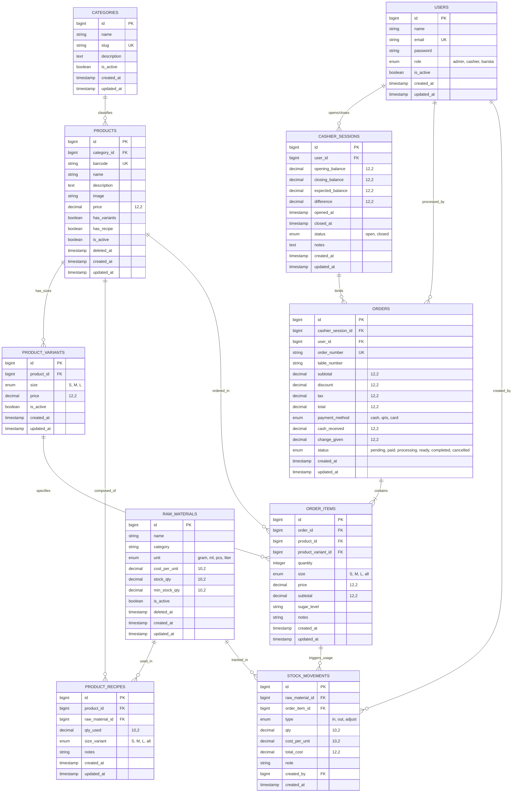

# Entity-Relationship Diagram (ERD) — BrewPOS

Dokumen ini mendokumentasikan skema arsitektur database relasional **BrewPOS** (MySQL 8.0 / InnoDB) yang mencakup 10 tabel inti sistem, relasi antar entitas (*foreign keys*), kardinalitas, tipe data, serta *business integrity invariants*.

---

## 1. Visual Entity-Relationship Diagram (Mermaid)



---

## 2. Kamus Data & Spesifikasi Entitas

### 2.1 USERS (Pengguna Sistem & RBAC)
Menyimpan kredensial dan hak akses seluruh staf kedai kopi.
- `id` (BIGINT, PK, Auto Increment)
- `name` (VARCHAR 255): Nama lengkap karyawan/operator.
- `email` (VARCHAR 255, Unique, Indexed): Kredensial login.
- `password` (VARCHAR 255): Hash Bcrypt kata sandi.
- `role` (ENUM: `'admin'`, `'cashier'`, `'barista'`): Menentukan hak akses middleware & menu navigasi.
- `is_active` (BOOLEAN, Default: `true`): Flag aktivasi. User non-aktif ditolak saat autentikasi.
- `created_at` / `updated_at` (TIMESTAMP).

### 2.2 CATEGORIES (Kategori Menu)
Klasifikasi kelompok minuman dan makanan (misal: Espresso Based, Non-Coffee, Signature, Bakery).
- `id` (BIGINT, PK, Auto Increment)
- `name` (VARCHAR 255): Nama kategori.
- `slug` (VARCHAR 255, Unique, Indexed): URL slug SEO-friendly.
- `description` (TEXT, Nullable): Deskripsi kategori.
- `is_active` (BOOLEAN, Default: `true`).
- `created_at` / `updated_at` (TIMESTAMP).

### 2.3 PRODUCTS (Katalog Menu POS)
Daftar seluruh item minuman dan makanan yang dijual.
- `id` (BIGINT, PK, Auto Increment)
- `category_id` (BIGINT, FK -> `categories.id`, Cascade on Delete).
- `barcode` (VARCHAR 64, Nullable, Unique, Indexed): Kode barcode EAN-13/SKU fisik scanner.
- `name` (VARCHAR 255): Nama produk.
- `description` (TEXT, Nullable): Keterangan komposisi rasa.
- `image` (VARCHAR 255, Nullable): Path berkas foto produk di `storage/app/public/`.
- `price` (DECIMAL 12,2): Harga dasar/default produk.
- `has_variants` (BOOLEAN, Default: `false`): Menandakan produk memiliki variasi ukuran (S, M, L).
- `has_recipe` (BOOLEAN, Default: `false`): Menandakan produk terikat dengan resep bahan baku.
- `is_active` (BOOLEAN, Default: `true`).
- `deleted_at` (TIMESTAMP, Nullable): Soft delete timestamp.
- `created_at` / `updated_at` (TIMESTAMP).

### 2.4 PRODUCT_VARIANTS (Variasi Ukuran Produk)
Menyimpan harga spesifik per ukuran cup (`S`, `M`, `L`) untuk produk dengan varian aktif.
- `id` (BIGINT, PK, Auto Increment)
- `product_id` (BIGINT, FK -> `products.id`, Cascade on Delete).
- `size` (ENUM: `'S'`, `'M'`, `'L'`): Ukuran cup/porsi.
- `price` (DECIMAL 12,2): Harga jual spesifik ukuran tersebut.
- `is_active` (BOOLEAN, Default: `true`).
- `created_at` / `updated_at` (TIMESTAMP).
- **Index Unique:** `['product_id', 'size']` (Mencegah duplikasi ukuran dalam 1 produk).

### 2.5 RAW_MATERIALS (Bahan Baku & Inventori Fisik)
Menyimpan data fisik stok biji kopi, susu, sirup, bubuk perasa, dan kemasan cup.
- `id` (BIGINT, PK, Auto Increment)
- `name` (VARCHAR 255): Nama bahan baku (misal: "Espresso Beans", "Fresh Milk").
- `category` (VARCHAR 255): Kategori bahan (Coffee, Dairy, Syrup, Powder, etc).
- `unit` (ENUM: `'gram'`, `'ml'`, `'pcs'`, `'liter'`): Satuan ukur fisik.
- `cost_per_unit` (DECIMAL 10,2): Harga pokok pembelian terakhir per unit.
- `stock_qty` (DECIMAL 10,2, Default: `0`): Jumlah stok fisik saat ini. Dilindungi CHECK constraint `stock_qty >= 0`.
- `min_stock_qty` (DECIMAL 10,2, Default: `0`): Batas minimum peringatan stok menipis (*low stock alert*).
- `is_active` (BOOLEAN, Default: `true`).
- `deleted_at` (TIMESTAMP, Nullable): Soft delete timestamp.
- `created_at` / `updated_at` (TIMESTAMP).

### 2.6 PRODUCT_RECIPES (Formula Resep / Bill of Materials)
Tabel *junction* penghubung produk ke bahan baku beserta takaran pemakaian per ukuran cup.
- `id` (BIGINT, PK, Auto Increment)
- `product_id` (BIGINT, FK -> `products.id`, Cascade on Delete).
- `raw_material_id` (BIGINT, FK -> `raw_materials.id`, Cascade on Delete).
- `qty_used` (DECIMAL 10,2): Kuantitas bahan yang dikonsumsi per 1 cup porsi.
- `size_variant` (ENUM: `'S'`, `'M'`, `'L'`, `'all'`, Default: `'all'`): Berlaku untuk ukuran tertentu atau semua ukuran.
- `notes` (VARCHAR 255, Nullable): Keterangan racikan.
- `created_at` / `updated_at` (TIMESTAMP).
- **Index Unique:** `['product_id', 'raw_material_id', 'size_variant']`.

### 2.7 CASHIER_SESSIONS (Sesi Shift & Rekonsiliasi Kas Laci)
Mencatat pembukaan shift kasir, modal kas awal, penjualan tunai, dan rekonsiliasi saat tutup shift.
- `id` (BIGINT, PK, Auto Increment)
- `user_id` (BIGINT, FK -> `users.id`): Kasir yang bertanggung jawab membuka shift.
- `opening_balance` (DECIMAL 12,2): Modal kas awal saat laci dibuka.
- `closing_balance` (DECIMAL 12,2, Nullable): Kas fisik riil dihitung saat shift ditutup.
- `expected_balance` (DECIMAL 12,2, Nullable): Kas seharusnya (`opening_balance + total_cash_sales`).
- `difference` (DECIMAL 12,2, Default: `0`): Selisih kas (`closing_balance - expected_balance`).
- `opened_at` (TIMESTAMP): Waktu buka shift.
- `closed_at` (TIMESTAMP, Nullable): Waktu tutup shift.
- `status` (ENUM: `'open'`, `'closed'`, Default: `'open'`).
- `notes` (TEXT, Nullable): Catatan serah terima shift antar kasir.
- `created_at` / `updated_at` (TIMESTAMP).

### 2.8 ORDERS (Header Transaksi Penjualan)
Mencatat setiap pesanan yang dibuat melalui layar POS kasir.
- `id` (BIGINT, PK, Auto Increment)
- `cashier_session_id` (BIGINT, FK -> `cashier_sessions.id`): Mengikat transaksi ke sesi shift aktif.
- `user_id` (BIGINT, FK -> `users.id`): Kasir operator transaksi.
- `order_number` (VARCHAR 255, Unique, Indexed): Nomor nota struk unik (`#TRX-XXXX`).
- `table_number` (VARCHAR 255, Nullable): Nomor meja pelanggan (opsional).
- `subtotal` (DECIMAL 12,2): Total tagihan sebelum diskon dan pajak.
- `discount` (DECIMAL 12,2, Default: `0`): Potongan harga.
- `tax` (DECIMAL 12,2): Pajak resto (PB1).
- `total` (DECIMAL 12,2): Total akhir yang harus dibayarkan pelanggan.
- `payment_method` (ENUM: `'cash'`, `'qris'`, `'card'`).
- `cash_received` (DECIMAL 12,2, Nullable): Uang tunai yang diserahkan pelanggan.
- `change_given` (DECIMAL 12,2, Nullable): Uang kembalian yang diberikan kasir.
- `status` (ENUM: `'pending'`, `'paid'`, `'processing'`, `'ready'`, `'completed'`, `'cancelled'`).
- `created_at` / `updated_at` (TIMESTAMP).

### 2.9 ORDER_ITEMS (Detail Item Pesanan)
Menyimpan setiap baris item menu dalam pesanan, catatan pesanan, dan snapshot harga saat transaksi.
- `id` (BIGINT, PK, Auto Increment)
- `order_id` (BIGINT, FK -> `orders.id`, Cascade on Delete).
- `product_id` (BIGINT, FK -> `products.id`).
- `product_variant_id` (BIGINT, FK -> `product_variants.id`, Nullable, Null on Delete).
- `quantity` (INTEGER): Jumlah pesanan item.
- `size` (ENUM: `'S'`, `'M'`, `'L'`, `'all'`, Default: `'M'`).
- `price` (DECIMAL 12,2): Harga satuan saat pesanan dibuat (mencegah fluktuasi jika harga menu diubah kelak).
- `subtotal` (DECIMAL 12,2): Total harga baris (`price * quantity`).
- `sugar_level` (VARCHAR 255, Nullable): Level gula (Normal, Less, No Sugar).
- `notes` (VARCHAR 255, Nullable): Catatan barista ("Less ice", "Hangatkan", dll).
- `created_at` / `updated_at` (TIMESTAMP).

### 2.10 STOCK_MOVEMENTS (Audit Trail Mutasi Inventori)
Log audit tidak dapat diubah (*immutable append-only log*) yang mencatat setiap gram/ml bahan yang keluar, masuk, atau disesuaikan.
- `id` (BIGINT, PK, Auto Increment)
- `raw_material_id` (BIGINT, FK -> `raw_materials.id`).
- `order_item_id` (BIGINT, FK -> `order_items.id`, Nullable): Mengaitkan konsumsi bahan dengan item pesanan spesifik.
- `type` (ENUM: `'in'`, `'out'`, `'adjust'`):
  - `'in'`: Penerimaan restock bahan dari supplier atau pembatalan void order.
  - `'out'`: Konsumsi otomatis akibat penjualan menu POS.
  - `'adjust'`: Koreksi selisih fisik / opname / tumpah / rusak.
- `qty` (DECIMAL 10,2): Jumlah kuantitas mutasi bahan.
- `cost_per_unit` (DECIMAL 10,2): Biaya satuan saat mutasi terjadi.
- `total_cost` (DECIMAL 12,2): Akumulasi nilai finansial (`qty * cost_per_unit`).
- `note` (VARCHAR 255, Nullable): Keterangan alasan mutasi.
- `created_by` (BIGINT, FK -> `users.id`): Karyawan/admin penanggung jawab mutasi.
- `created_at` (TIMESTAMP, Use Current).

---

## 3. Relasi, Integritas Relasional & Foreign Keys

| Parent Table | Child Table | Foreign Key Column | On Delete Action | Penjelasan Relasi |
| :--- | :--- | :--- | :--- | :--- |
| `categories` | `products` | `category_id` | `CASCADE` | Setiap produk wajib tergolong dalam 1 kategori. |
| `products` | `product_variants` | `product_id` | `CASCADE` | Variasi ukuran otomatis terhapus jika produk induk dihapus. |
| `products` | `product_recipes` | `product_id` | `CASCADE` | Resep otomatis terhapus jika produk induk dihapus. |
| `raw_materials` | `product_recipes` | `raw_material_id` | `CASCADE` | Menghapus bahan baku menghapus formulanya dari resep. |
| `users` | `cashier_sessions` | `user_id` | `RESTRICT` | Sesi shift kasir terikat permanen ke kasir pembuka. |
| `cashier_sessions` | `orders` | `cashier_session_id` | `RESTRICT` | Order penjualan wajib terikat ke sesi shift kasir aktif. |
| `users` | `orders` | `user_id` | `RESTRICT` | Riwayat kasir penanggung jawab transaksi. |
| `orders` | `order_items` | `order_id` | `CASCADE` | Seluruh baris item otomatis terhapus bersama order induk jika order di-purge. |
| `products` | `order_items` | `product_id` | `RESTRICT` | Mencegah penghapusan produk yang telah memiliki riwayat transaksi. |
| `product_variants` | `order_items` | `product_variant_id`| `SET NULL` | Tetap mempertahankan riwayat order item meskipun varian non-aktif. |
| `raw_materials` | `stock_movements` | `raw_material_id` | `RESTRICT` | Log mutasi bahan baku tidak boleh hilang untuk audit integritas inventori. |
| `order_items` | `stock_movements` | `order_item_id` | `RESTRICT` / `SET NULL` | Jejak konsumsi bahan terhubung langsung ke pesanan kasir. |
| `users` | `stock_movements` | `created_by` | `RESTRICT` | Jejak otentik operator/admin yang melakukan restock/penyesuaian stok. |

---

## 4. Database Invariants & Concurrency Guards

1. **Check Constraint Non-Negative Stock (`INV-01`):**
   Tabel `raw_materials` dilindungi oleh database CHECK constraint:
   ```sql
   ALTER TABLE raw_materials ADD CONSTRAINT chk_raw_materials_stock_qty_non_negative CHECK (stock_qty >= 0);
   ```
2. **Pessimistic Locking & Deadlock Elimination (`F-CNC-01` & `F-CNC-02`):**
   Seluruh pengurangan stok (`InventoryDeductionService::deductOrderStock`), pengembalian stok pembatalan (`restoreOrderStock`), dan penambahan restock mengeksekusi `RawMaterial::orderBy('id', 'asc')->lockForUpdate()` di dalam transaksi atomik (`DB::transaction(..., 3)`), memastikan tidak ada *circular wait deadlock*.
3. **Session Ownership & IDOR Protection (`POS-01` & `POS-04`):**
   Kasir dibatasi hanya dapat melihat transaksi, mencetak struk, atau membatalkan pesanan pada sesi shift yang aktif miliknya (`cashier_session_id = Auth::user()->activeSession->id`).
4. **Barcode SKU Uniqueness (`POS-05`):**
   Kolom `products.barcode` memiliki indeks unik yang mencegah konflik pemindaian scanner hardware antar item menu yang berbeda.
